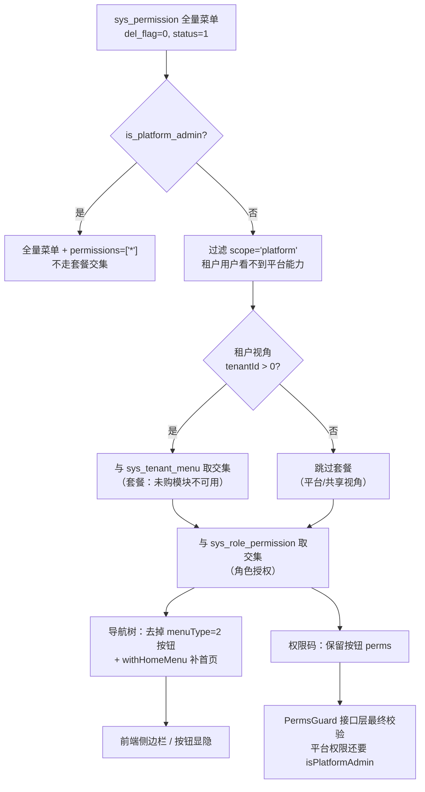

# 租户体系与后端底座优化分析

- 分析对象：`concise-server-node`
- 分析日期：2026-11-19
- 范围：多租户隔离、租户生命周期、权限/套餐、后台任务、开放平台；兼顾底座层面的通用逻辑问题
- 结论：当前租户模型已经做过不少加固（JWT 按租户收窄角色、`PermsGuard` 平台权限前置拦截、`BaseService` 自动读写隔离、严格写条件等），但隔离仍依赖“每个查询手写条件”。少数自定义写路径绕过了基类保护，另有模块（日程、开放平台）没有完整接入租户模型。这些问题集中在 **写越权、套餐失效、非 HTTP 上下文失配** 三类。

---

## 一、总体判断

### 1.1 当前模型

| 概念 | 实现 |
| --- | --- |
| 平台视角 | `TenantContext.filterTenantId() === null`，查询不加租户条件 |
| 平台共享数据 | `tenant_id = 0`，所有租户可见 |
| 租户数据 | `tenant_id > 0`，仅本租户 + 共享数据可见 |
| 用户归属 | `sys_user` 是全局身份，`sys_user_tenant` 表达“属于哪些租户” |
| 租户角色 | `sys_role.tenant_id` 区分归属；`tenant_id = 0` 是平台共享角色 |
| 功能套餐 | `sys_tenant_menu` 记录租户已开通菜单 |
| 请求上下文 | `TenantMiddleware` 解析 JWT + `X-Tenant-Id`，写入 `AsyncLocalStorage` |

### 1.2 已经做对的部分

- `TenantAccessService` 只认 `sys_user.is_platform_admin`，不再按 `role_code` 判超管。
- `JwtStrategy` 会按当前租户过滤 `req.user.roles`，避免 A 租户的 admin 角色在 B 租户继续生效。
- `BaseService.update/delete` 使用 `tenantWriteCondition`，严格只写本租户，不写共享行。
- `PermsGuard` 对 `scope = 'platform'` 的权限点要求平台管理员。
- 日志按租户严格等值隔离，平台日志不会泄漏给租户。
- 定时任务通过 `TenantContext.withTenant(taskTenantId, ...)` 注入租户上下文。

### 1.3 核心风险排序

| 编号 | 级别 | 问题 | 主要影响 |
| --- | --- | --- | --- |
| P0-1 | 严重 | 角色更新/删除/授权写路径未做严格租户写隔离 | 租户管理员可改共享角色或按 ID 改任意租户角色 |
| P0-2 | 严重 | 功能套餐只影响前端菜单，不影响 `PermsGuard`；空套餐反而全开 | 收窄套餐后接口仍可调用，套餐形同虚设 |
| P0-3 | 严重 | 日程模块三张表没有 `tenant_id`，公开日历全局可见 | 跨租户读取日程；可伪造 `ownerId` 建日历 |
| P0-4 | 严重 | 开放平台按 `sys_user.tenant_id` 过滤，但该列不存在 | 租户应用 500；平台应用可拉全平台用户 |
| P0-5 | 高 | 客户/订单/部门的自定义删除绕过严格写条件 | 租户可软删平台共享数据 |
| P1-1 | 高 | 重跑租户初始化会把收窄的套餐/角色授权重新放大 | 平台收窄套餐被一次“同步”覆盖 |
| P1-2 | 高 | 用户删除/移除租户/删除租户的清理链断裂 | 软删用户阻塞租户删除；孤儿角色关联 |
| P1-3 | 高 | 自助开通租户后鉴权缓存未失效；配额检查在事务外 | 新管理员 30 秒内无权限；并发超额 |
| P1-4 | 高 | 取消平台管理员后 `TenantAccessService` 缓存未失效 | 最长 30 秒仍以平台视角读全库 |
| P1-5 | 中高 | 平台视角创建的用户默认落租户 1、业务数据落共享 0 | 平台账号被租户 1 管理；业务数据全局可见 |
| P1-6 | 中高 | 非 HTTP 上下文默认 `null`（不过滤） | 定时任务/提醒/未来消费者容易全库读写 |

---

## 二、P0：安全与隔离问题

### P0-1 角色写接口没有严格租户写条件

**证据**

- `src/helper/crud/base.service.ts:85-91`：`findOne` 的读范围包含 `tenant_id = 0`（共享行）。
- `src/helper/crud/base.service.ts:128-133`：基类 `update` 明确使用 `tenantWriteCondition`，注释写明“共享数据只有平台视角能改”。
- `src/modules/role/role.service.ts:129-158`：`updateRole` 先用 `this.findOne(id)` 读，随后直接 `manager.getRepository(RoleEntity).update(id, ...)`，没有租户写条件。
- `src/modules/role/role.service.ts:179-204`：`deleteRole` 同样先读后按 ID 硬删。
- `src/modules/role/role.service.ts:230-239`：`assignMenus` 用 `roleRepo.findOne({ where: { id } })`，完全没有租户范围。
- `src/modules/role/role.v1.controller.ts:204-208`：`PUT /v1/roles/:id/menus` 直接调用 `assignMenus`，没有先走带租户范围的 `findOne`。
- `src/modules/role/role.service.ts:82-91`：`listOptions` 使用读范围（本租户 + 共享），所以租户管理员能拿到 `tenant_id = 0` 共享角色的 ID。
- `src/modules/role/role.service.ts:99-101`：平台视角创建角色会显式落 `tenant_id = 0`，即共享角色是受支持的产品能力，不是脏数据。

**攻击链**

1. 租户管理员拥有 `system:role:update`（租户级权限，admin 模板默认具备）。
2. 通过 `GET /v1/roles/options` 看到共享角色 ID。
3. 调用 `PUT /v1/roles/{共享角色ID}/menus`，`assignMenus` 按 ID 找到共享角色，重写 `sys_role_permission`。
4. `PermissionCacheService.invalidateRole` 立即清缓存，所有租户中持有该共享角色的用户立刻获得新权限；反之也可以清空权限造成拒绝服务。
5. `updateRole` 还能改共享角色的 `status`、`dataScope`、`roleCode`，影响所有租户。
6. 如果拿到其他租户的角色 ID，直接调用 `PUT /v1/roles/:id/menus` 也能改写对方角色；写成功后控制器再调 `getMenuIds(id)`，由于 `getMenuIds` 走的是带范围的 `findOne`，会返回 404，但写入已经发生，隐蔽性很强。

**影响**

- 跨租户权限篡改、共享角色拒绝服务。
- 与 `BaseService` 的写保护语义不一致，属于明确的安全回归。

**修复建议**

- `RoleService.updateRole/deleteRole/assignMenus` 的角色加载统一使用“严格写范围”：
  - 租户上下文：只允许 `role.tenant_id === 当前租户`；
  - `tenant_id = 0` 的共享角色：只有平台视角（`filterTenantId() === null`）可写；
  - 其他租户角色：404/403，不返回存在性信息。
- 更新/删除 SQL 追加 `tenantWriteCondition()`，不要只依赖先读。
- `batchDelete` 的目标查询也加租户范围，避免跨租户名称泄漏。
- 增加测试：租户 A 管理员对共享角色、租户 B 角色执行更新/删除/授权，必须全部失败且数据不变。

---

### P0-2 功能套餐只在前端生效，`PermsGuard` 仍按原始角色权限放行

**证据**

- `src/modules/auth/services/auth.service.ts:298-311`：套餐只用于过滤登录返回的菜单/权限码；`packageRows.length === 0` 时直接不限制（fail-open）。
- `src/common/guards/perms.guard.ts:56-67`：`PermsGuard` 只取 `sys_role_permission` 的权限并集，没有和 `sys_tenant_menu` 取交集。
- `src/modules/role/role.service.ts:252-265`：`assignMenus` 在“写”时校验套餐，但已存在的超套餐授权不会回收。
- `src/modules/system/tenant/tenant-package.service.ts:41-45`：注释写的是“表无行 = 空套餐 = 无可授权菜单”，与 `AuthService` 的“无行 = 不限制”完全相反。
- `src/modules/system/tenant/tenant-package.service.ts:54-84`：`setPackage` 允许传空数组，即平台可以把套餐收成 0 条。
- 共享角色（`tenant_id = 0`）在 `assignMenus` 中不进入套餐校验分支（`roleTenantId > 0` 才校验），租户用户绑定共享角色时可绕过套餐。

**影响**

- 平台收窄套餐后，租户用户仍能直接调用被收回模块的接口（只要角色历史上授过权）。
- 平台把套餐清空，登录反而看到全部菜单/权限码（fail-open），与“停用全部功能”的预期完全相反。
- “套餐”目前更像 UI 开关，不是权限边界。

**修复建议**

- 定义唯一口径：**租户有效权限 = 角色权限 ∩ 套餐菜单权限**，在 `PermsGuard` 内执行；平台视角/平台管理员不参与交集。
- 套餐缓存按租户维度放 Redis，`setPackage` 后失效；空套餐按“无权限”处理（fail-closed），如需兼容存量租户，增加显式开关/迁移标记，而不是默认放行。
- 共享角色要么禁止分配给租户用户，要么在计算时同样与租户套餐取交集。
- `setPackage` 同时失效 `PermissionCacheService`（如果守卫使用套餐缓存）和 `AuthUserCacheService`。
- 补测试：收窄套餐后旧 token 调用被收回接口必须 403；空套餐必须无任何租户级权限。

---

### P0-3 日程模块没有接入租户模型

**证据**

- `sql/concise_server_full_2026-11-17.sql:25-37`：`base_calendar` 只有 `owner_id`、`is_public`，没有 `tenant_id`。
- `sql/concise_server_full_2026-11-17.sql:55-73`：`base_schedule_event` 同样没有 `tenant_id`；`base_schedule_reminder_log` 也没有。
- `src/modules/schedule/schedule.service.ts:39`：日历列表查询 `where: [{ ownerId }, { isPublic: true }]`，公开日历对所有租户可见。
- `src/modules/schedule/schedule.service.ts:43`：创建日历时 `const ownerId = dto.ownerId ? dto.ownerId : userId`，`ownerId` 来自客户端且没有“仅平台管理员可代建”的校验。
- `src/modules/schedule/schedule.service.ts:94`：可见日历集合同样包含所有 `isPublic = true` 的日历。
- `src/modules/schedule/reminder.scheduler.ts:39,81`：提醒扫描直接查全表，没有租户上下文。

**影响**

- 租户 A 的用户能看到租户 B 标记为公开的日历及日程标题、时间、描述。
- 任意登录用户可以创建一个归属其他用户的日历（只要知道对方用户 ID），造成越权写入/骚扰。
- 提醒任务全局扫描，后续一旦按用户发送消息，容易跨租户投递。

**修复建议**

- 三张表补 `tenant_id`（`base_calendar`、`base_schedule_event`、`base_schedule_reminder_log`），迁移时按 `owner_id` 的 `sys_user_tenant` 主归属回填，无法回填的落 0。
- 服务层所有查询加 `applyTenantScope`；写路径加 `tenantWriteCondition` 或显式校验。
- `ownerId` 代建只允许平台管理员，且目标用户必须属于目标租户（或平台账号）。
- 提醒任务按事件/日历的 `tenant_id` 分组，逐租户 `withTenant` 执行；不要在全库上下文里查。
- 如果“公开日历”是产品需求，明确为“租户内公开”，跨租户公开需要单独的产品决策。

---

### P0-4 开放平台应用令牌的租户过滤引用不存在的列

**证据**

- `src/modules/openapi/open.v1.controller.ts:45-49`：`applyAppTenantScope` 使用 `u.tenant_id = :tenantId`。
- `sql/concise_server_full_2026-11-17.sql` 的 `sys_user` 表没有 `tenant_id` 列；用户归属在 `sys_user_tenant`。
- `src/modules/auth/strategies/jwt.strategy.ts:60-74`：应用令牌返回 `tenantId: app.tenantId`。
- `src/shared/tenant/tenant.middleware.ts:41-60`：中间件把 JWT 的 `payload.id` 当用户 ID 去 `TenantAccessService` 解析；应用令牌的 `id` 是应用 ID，因此 `TenantContext` 落到租户 0。
- `src/modules/openapi/open.v1.controller.ts:54-56,70-72`：开放接口使用 `req.user.tenantId` 过滤；`tenantId = 0`（平台应用）时完全不加条件。

**影响**

- 归属租户的应用令牌调用 `/v1/open/users` 时会因 `Unknown column 'u.tenant_id'` 直接 500。
- 平台应用令牌（`tenantId = 0`）可以拉取全平台用户（含姓名、邮箱），超出“平台应用可见全平台”的预期边界时需要产品确认。
- 任何依赖 `TenantContext` 的开放接口逻辑都会落到租户 0，读到的是共享数据而不是应用归属租户。

**修复建议**

- 用户过滤改为 `EXISTS (SELECT 1 FROM sys_user_tenant ut WHERE ut.user_id = u.id AND ut.tenant_id = :tenantId AND ut.status = 0)`。
- `TenantMiddleware` 识别 `payload.app === true`：用应用归属租户构造上下文，或为应用令牌设置显式的 `app` 上下文，不要把应用 ID 当用户 ID。
- 平台应用是否可见全平台用户，写成明确的产品/安全规则，并加测试。
- 开放接口新增字段时继续走字段白名单，不要复用用户侧序列化。

---

### P0-5 自定义删除绕过严格租户写条件

**证据**

- `src/helper/crud/base.service.ts:85-91`：读路径允许读到 `tenant_id = 0` 共享行。
- `src/helper/crud/base.service.ts:187-198`：基类删除使用严格写条件。
- `src/modules/customer/customer.service.ts:88-91`：`findOne(id)` 后直接 `repository.update(entity.id, { delFlag: 1 })`。
- `src/modules/biz_order/biz_order.service.ts:90-93`：同样的模式。
- `src/modules/system/dept/dept.service.ts:108-124`：`findOne(id)` 后直接 `repository.update(id, { delFlag: '1' })`；`batchDelete` 的目标查询 (`:129`) 也没有租户范围。

**影响**

- 租户管理员可以对平台视角创建的共享客户/订单/部门执行软删，影响所有租户。
- `batchDelete` 还会把其他租户的 ID 查出来，失败结果里带出对方名称，形成轻量信息泄漏。

**修复建议**

- 增加统一的 `softDelete(id, patch)` 基类方法，内部强制 `tenantWriteCondition`；所有自定义删除改用它。
- 对 `tenant_id = 0` 的业务数据默认只读；如果确实需要平台共享，单独标注 `shared` 并禁止租户写。
- `batchDelete` 的目标查询统一走带租户范围的 QueryBuilder。
- 增加“共享行不可写”的通用测试矩阵。

---

## 三、P1：逻辑一致性问题

### P1-1 重跑租户初始化会把收窄的套餐和角色授权重新放大

**证据**

- `src/modules/system/tenant/tenant-provision.service.ts:108-136`：`packageIds` 是三个模板角色应得菜单的并集；admin 档是全集，所以实际上等于全部租户级菜单。
- `src/modules/system/tenant/tenant-provision.service.ts:141-161`：`upsertPackage` 只新增缺失行，从不删除；注释说“重跑 provision 不该把套餐偷偷放大回全量”，但实现正是把被平台删掉的菜单重新加回来。
- `src/modules/system/tenant/tenant-provision.service.ts:183-199`：`grant` 只补差集，会把管理员从 editor/viewer 角色中手动移除的权限重新加回。
- `src/modules/system/tenant/tenant.v1.controller.ts:105-109,145-151`：`provision-all` 和单租户 `provision` 都是平台管理员可触发的常规接口。

**影响**

- 平台管理员收窄某个租户的套餐后，只要执行一次“同步全部角色/补齐新菜单”，套餐就恢复成全量。
- 租户自定义的 editor/viewer 权限也会被模板重置，且没有提示。

**修复建议**

- 拆分三个语义：
  1. `bootstrap`：仅新建租户时执行；
  2. `syncNewMenus`：只补“本次新增的菜单节点”，不碰历史上被移除的节点；
  3. `resetToTemplate`：显式重置，需要二次确认并记录审计。
- 用 `sys_tenant.template_version` 或一张 `sys_tenant_provision_log` 记录已同步到哪个菜单版本，避免每次全量对齐。
- `grant` 同理，只对“模板新增”授权，不对“被手动移除”授权做补回。

---

### P1-2 用户删除、移除租户、删除租户的清理链断裂

**证据**

- `src/modules/user/user.service.ts:968-993`：软删用户时清 `sys_user_role/sys_user_depart/sys_user_post/watermark`，但没有清 `sys_user_tenant`。
- `src/modules/system/tenant/tenant.service.ts:255-263`：删除租户前用 `userTenantRepository.count({ tenantId, status: 0 })` 判断“还有用户”，软删用户的关联行仍会被计入。
- `src/modules/system/tenant/tenant.service.ts:405-419`：租户用户列表只查 `sys_user.del_flag = 0`，软删用户不会出现在列表里，管理员没有入口移除他们。
- `src/modules/system/tenant/tenant.service.ts:443-475`：`assignUsers` 移除成员时只删 `sys_user_tenant`，不删该成员在本租户的角色关联，也不失效 `AuthUserCache`。
- `src/modules/system/tenant/tenant.service.ts:264-278`：删除租户时删角色、角色授权、成员关系，但没有清 `sys_user_role`、`sys_tenant_menu`，也没有清 `AuthUserCache`。

**影响**

- 某租户下只要有过软删用户，租户就永远无法删除：删除接口说“还有 N 个用户”，列表里又看不到这些人。
- 被移出租户的用户重新加入后，旧角色自动复活，权限状态不可控。
- 孤儿 `sys_user_role`、`sys_tenant_menu` 长期累积；共享角色缓存/用户缓存可能短暂保留已删角色。

**修复建议**

- 软删用户时同步处理 `sys_user_tenant`：物理删除，或置 `status = 1` 并在所有统计/解析中过滤。
- 删除租户的“还有用户”统计改为 join `sys_user` 且 `del_flag = 0`；同时提供“清理无效成员”能力。
- `assignUsers` 移除成员时，删除该用户在本租户角色上的 `sys_user_role` 行，并失效该用户的鉴权缓存。
- 删除租户时按角色 ID 清理 `sys_user_role`，清理 `sys_tenant_menu`，最后 `authUserCache.invalidateAll()`。
- 增加生命周期测试：建租户 → 建用户 → 软删用户 → 删租户。

---

### P1-3 自助开通租户后的缓存与配额问题

**证据**

- `src/modules/system/tenant/tenant.service.ts:176-223`：`applyQuota` 在事务外检查；事务内插入 `sys_user_tenant`、`sys_user_role`、更新 `login_tenant_id`；事务后只执行 `permissionCache.invalidateAll()` 和 `tenantAccess.invalidate()`。
- `src/modules/auth/strategies/jwt.strategy.ts:118-124`：`AuthUserCacheService` 缓存用户及角色 30 秒。
- `src/modules/system/tenant/tenant.service.ts:210`：`INSERT INTO sys_user_role (user_id, role_id)` 没有写 `tenant_id`，与 `UserService.assignRoles` 的 `(id, user_id, role_id, tenant_id)` 不一致。

**影响**

- 用户自助开通租户后，新 admin 角色不在其 JWT 用户缓存里，最长 30 秒内 `PermsGuard` 认为他没有权限。
- 并发两次“开通”可能都通过配额检查，突破 VIP 可开通数量。
- `sys_user_role.tenant_id` 出现 0 与真实租户混用，后续若按该列清理/统计会失真。

**修复建议**

- 事务成功后 `authUserCache.invalidate(userId)`（或 `invalidateAll()`）。
- 配额检查移入事务，对 `sys_user` 行加 `FOR UPDATE`，或使用“租户计数 + 唯一约束”的原子方案。
- 所有 `sys_user_role` 插入统一带 `tenant_id`，并明确该列的唯一用途；如果不用，考虑删除该列，避免“看起来有、实际不维护”。

---

### P1-4 取消平台管理员后租户上下文缓存未失效

**证据**

- `src/modules/user/user.service.ts:1101-1122`：`setPlatformAdmin` 只调用 `authUserCache.invalidate(id)`，没有通知 `TenantAccessService`。
- `src/shared/tenant/tenant-access.service.ts:42-79`：`isSuper` 按 `userId` 缓存 30 秒。
- `src/shared/tenant/tenant-access.service.ts:91-100`：平台管理员未带 `X-Tenant-Id` 时返回 `tenantId: null`（查询不过滤）。
- `src/shared/tenant/tenant.middleware.ts:59-61`：`isSuper` 来自这份缓存。

**影响**

- 取消平台管理员后，在缓存过期的 30 秒内，该用户仍可能拿到 `tenantId = null`，从而读全库数据。
- `PermsGuard` 用的是 `req.user.isPlatformAdmin`（已失效，平台级接口会拦），但大量租户级列表接口在没有租户过滤时会返回所有租户的数据。
- 多实例部署时窗口取决于实例各自的缓存，无法通过单机失效解决。

**修复建议**

- `UserService.setPlatformAdmin` 注入 `TenantAccessService` 并 `invalidate(id)`；`UserService.delete` 同理。
- 统一“是否平台管理员”的读取来源：中间件和守卫都从同一份鉴权用户缓存取，避免双缓存漂移。
- 多实例用 Redis 发布失效事件，或把 `isSuper` 放进短 TTL 的共享缓存。

---

### P1-5 平台视角创建数据的归属歧义

**证据**

- `src/modules/user/user.service.ts:266-271,285-288`：平台视角创建用户时，`resolveJoinTenantId()` 强制落到默认租户 1。
- `src/helper/crud/base.service.ts:101-106`：平台视角创建带 `tenant_id` 的业务数据时，统一落 `tenant_id = 0`（共享）。
- `src/modules/system/log/log.service.ts:97-113`：登录日志拿不到归属时也兜底租户 1。
- `src/modules/system/tenant/tenant.service.ts:255-258`：租户 1 被硬编码为“默认租户，不允许删除”。

**影响**

- 平台创建的普通账号自动成为租户 1 的成员，租户 1 的管理员可以在用户列表里看到甚至管理这些平台账号。
- 平台创建的客户/订单等业务数据成为“全租户共享”，是否真的想让所有租户看到，需要产品确认。
- 租户 1 成为事实上的“平台托管租户”，与其他租户行为不一致；租户 1 被停用/过期时，平台新建账号会直接不可用。

**修复建议**

- 区分“共享参考数据”（字典、菜单）与“租户业务数据”：后者禁止平台视角直接写 0，必须先选租户。
- 平台工作人员使用“无租户归属”的账号（`tenantId = 0` 上下文），不要强制加入租户 1。
- 默认租户改为显式配置（`tenant.defaultId`）或 `sys_tenant.is_default`，不要硬编码 1。
- 登录失败日志的兜底租户单独定义（平台日志），不要把失败记录塞进租户 1。

---

### P1-6 非 HTTP 上下文默认“不过滤”

**证据**

- `src/shared/tenant/tenant.context.ts:35-39`：`filterTenantId()` 在无 `AsyncLocalStorage` 时返回 `null` = 不过滤。
- `src/modules/ops/job/job.scheduler.ts:162-167`：任务调度器已经显式 `withTenant`，这是正确做法。
- `src/modules/schedule/reminder.scheduler.ts`：提醒扫描没有 `withTenant`，直接全表查询。
- 代码中只有 `job.scheduler.ts` 和 `tenant.service.ts` 两处调用 `withTenant`。

**影响**

- 任何新增的定时任务、队列消费者、Webhook 处理、启动预热脚本，只要忘记包上下文，就会全库读写；写库还会被 `stampTenant` 打成 `tenant_id = 0`。
- 这是“默认放行”的架构，而不是“默认拒绝”。

**修复建议**

- 引入显式的系统上下文：`TenantContext.runAsSystem(reason)` / `requireTenant()`；后台任务必须二选一，否则抛错。
- 在仓储层/TypeORM subscriber 层检测：带 `tenant_id` 的表在没有上下文时拒绝查询（或至少记录 ERROR 告警）。
- 把所有后台入口列成清单，纳入代码评审检查项。

---

## 四、P2：数据一致性、性能与可维护性

### 4.1 缺少租户存在性校验

- `src/modules/system/tenant/tenant-package.service.ts:54-84`：`setPackage` 注释说“调用方需先确认租户存在”，但 `tenant.v1.controller.ts:75-79` 并没有调用 `findOne`；对不存在的租户会写入孤儿 `sys_tenant_menu`。
- `src/modules/system/tenant/tenant-provision.service.ts:59-64`：`provision(tenantId)` 自身不校验租户存在；目前 `tenant.v1.controller.ts:145-151` 先调了 `tenantService.findOne(id)`，但服务内部没有防御，后续任何内部调用都可能对不存在的租户写入角色/套餐。
- `getPackageDetail` 同样不校验（只读影响较小，但会把 `setPackage` 留下的孤儿套餐项原样返回）。

建议：所有平台级写接口先 `tenantService.findOne(id)`；套餐/初始化服务内部也加一道防御。

### 4.2 字典项读路径与写路径口径不一致

- `src/modules/system/dict/dict-item.service.ts:62-90`：`listByCode` 只按 `dictId` 取字典项，没有 `applyTenantScope(item)`。
- `src/modules/system/dict/dict-item.service.ts:168-180`：写路径禁止租户在共享字典下加字典项。

目前写路径堵住了主要入口，但历史数据/手工数据中的租户专属项挂在共享字典下时，所有租户都会看到。建议读路径也按 `tenant_id IN (0, current)` 过滤，与 `listByQuery` 一致。

### 4.3 文件上传的同名覆盖查询缺少租户范围

- `src/modules/tools/file/file.service.ts:263`：`findOne({ ownerId, parentId, name, isDeleted: 0 })` 没有租户条件。
- 同一用户属于多个租户时，可能在租户 B 覆盖/跳过租户 A 的同名文件；`overwriting` 保存时也不会改 `tenantId`。
- `restore` 的父目录查找（`file.service.ts:469` 附近）同样只按 `ownerId`，建议统一加租户范围。

### 4.4 缓存与多实例

- `src/shared/tenant/tenant-access.service.ts:42-79`：进程内 Map，30 秒 TTL；过期条目只在同一用户再次访问时删除，冷用户条目会长期滞留（与注释描述不符）。
- `src/shared/auth-cache/auth-user-cache.service.ts:15-48`：进程内缓存，失效只影响本实例。
- `src/modules/system/config/system-config.service.ts:47-48,270-281`：进程内全量配置缓存，30 秒；多实例写入后其他实例最多 30 秒才生效。
- `src/shared/permission-cache/permission-cache.service.ts:69-75`：每个请求按角色逐个 `GET`，角色多时建议 `MGET`/pipeline。

建议：租户归属、鉴权用户、配置缓存统一走 Redis 或增加版本号；至少把 TTL 降到秒级并在文档中写明多实例边界；`TenantAccessService` 增加定期清理/容量上限。

### 4.5 数据清理与冗余列

- `sys_user_role.tenant_id` 只有插入路径维护（`user.service.ts:377`），`tenant.service.ts:210` 又不写；该列目前没有任何查询使用。
- `sys_tenant_menu`、`sys_user_role` 在租户删除后可能残留。
- `sys_webhook` 缺少 `(tenant_id, del_flag, create_time)` 复合索引；`sys_file`、`sys_announcement` 也可按实际查询补复合索引。

建议：要么让 `tenant_id` 列成为唯一事实来源并补清理，要么删列；不要保留“半维护”状态。

### 4.6 无租户专项测试

当前只有工具类单测，没有看到租户隔离的 e2e 测试。建议至少覆盖：

- 租户 A/B/平台/共享四类主体的列表、详情、更新、删除；
- 共享角色、共享客户/订单/部门不可被租户写；
- 套餐收窄/清空后的接口 403；
- 软删用户后租户删除；
- 取消平台管理员后的即时降权；
- 应用令牌的租户过滤；
- 并发开通租户的配额。

---

## 五、分阶段改造方案

### 第 0 阶段：止血（1-2 天）

目标：先消除可直接利用的写越权和明显泄漏。

1. **角色写路径**
   - `updateRole/deleteRole/assignMenus` 加严格租户条件；
   - 租户上下文禁止写 `tenant_id = 0` 角色；
   - `batchDelete` 目标查询加范围；
   - 补跨租户/共享角色测试。
2. **共享数据删除**
   - `customer/biz_order/dept` 的自定义删除改用 `tenantWriteCondition`；
   - `dept.batchDelete` 目标查询加范围。
3. **日程**
   - 加 `tenant_id` 迁移与回填；
   - 服务层读写信封；
   - `ownerId` 代建仅平台管理员；
   - 提醒任务按租户执行。
4. **开放平台**
   - 用户过滤改 `EXISTS sys_user_tenant`；
   - 中间件识别应用令牌，设置正确的租户上下文。

### 第 1 阶段：逻辑一致（约 1 周）

1. **套餐运行时生效**
   - `PermsGuard` 取“角色权限 ∩ 套餐”；
   - 空套餐 fail-closed；
   - 套餐缓存 + 失效；
   - 共享角色与套餐的关系明确。
2. **初始化语义拆分**
   - `bootstrap` / `syncNewMenus` / `resetToTemplate`；
   - 记录模板版本，禁止重跑放大。
3. **生命周期清理**
   - 软删用户处理 `sys_user_tenant`；
   - 移除成员删除本租户角色；
   - 删除租户清理 `sys_user_role`、`sys_tenant_menu`、`authUserCache`；
   - 删除租户人数统计只算未删用户。
4. **缓存一致性**
   - `setPlatformAdmin` 失效租户归属缓存；
   - 多实例失效机制（Redis pub/sub 或版本号）；
   - 自助开通后失效申请人鉴权缓存。
5. **配额原子性**
   - 配额检查移入事务，锁用户行或使用计数表。

### 第 2 阶段：架构收敛（2-3 周）

1. **单一隔离入口**
   - 方案 A：TypeORM subscriber/Repository 包装器，对带 `tenant_id` 的实体自动注入条件，缺少上下文直接抛错；
   - 方案 B：数据库 RLS（如迁移到 PostgreSQL）或视图层隔离。
   - 目标：业务代码不再手写 `applyTenantScope`，漏写不会被默认放行。
2. **上下文语义**
   - 明确 `platform` / `tenant` / `shared` / `system` 四种作用域；
   - 后台任务必须显式 `runAsSystem` 或 `withTenant`；
   - 启动时扫描并打印所有未包上下文的后台入口。
3. **租户数据治理**
   - 租户删除后的数据保留/导出/物理清理策略；
   - 平台共享数据与租户业务数据分表或加 `shared` 标记；
   - 默认租户配置化。
4. **可观测性**
   - 日志、指标、链路都带 `tenant_id`；
   - 对跨租户 ID 访问、共享行写入、套餐越权调用做告警；
   - 增加按租户的限流/配额。

---

## 六、验收清单

- [ ] 租户 A 管理员无法读取/修改/删除租户 B 的任何角色、用户、部门、客户、订单、日历。
- [ ] 租户 A 管理员无法修改/删除 `tenant_id = 0` 的共享角色、共享客户/订单/部门。
- [ ] 套餐收窄后，旧 token 调用被收回接口返回 403；套餐清空后无任何租户级权限。
- [ ] 平台应用令牌与租户应用令牌的可见用户范围符合约定，且不会 SQL 报错。
- [ ] 重跑租户初始化不会恢复已删除的套餐项/角色授权。
- [ ] 软删用户后可以正常删除租户；删除租户后无孤儿 `sys_user_role`、`sys_tenant_menu`。
- [ ] 取消平台管理员后，下一次请求即失去平台视角；不存在 30 秒全库读取窗口。
- [ ] 并发开通租户不会突破 VIP 配额。
- [ ] 无租户上下文的后台任务查询带 `tenant_id` 的表时，会显式报错或告警，而不是全表扫描。

---

## 七、关键文件索引

- 租户上下文：`src/shared/tenant/tenant.context.ts`
- 租户作用域：`src/shared/tenant/tenant-scope.util.ts`
- 租户中间件：`src/shared/tenant/tenant.middleware.ts`
- 租户归属：`src/shared/tenant/tenant-access.service.ts`
- 通用 CRUD：`src/helper/crud/base.service.ts`
- 权限守卫：`src/common/guards/perms.guard.ts`
- 鉴权策略：`src/modules/auth/strategies/jwt.strategy.ts`
- 登录权限：`src/modules/auth/services/auth.service.ts`
- 角色服务：`src/modules/role/role.service.ts`
- 租户服务：`src/modules/system/tenant/tenant.service.ts`
- 租户初始化：`src/modules/system/tenant/tenant-provision.service.ts`
- 租户套餐：`src/modules/system/tenant/tenant-package.service.ts`
- 用户服务：`src/modules/user/user.service.ts`
- 日程服务：`src/modules/schedule/schedule.service.ts`
- 日程提醒：`src/modules/schedule/reminder.scheduler.ts`
- 开放接口：`src/modules/openapi/open.v1.controller.ts`
- 全量建表脚本：`sql/concise_server_full_2026-11-17.sql`

> 注：以上行号以当前代码为准，后续改动后请以文件内容为准。

---

## 八、实施记录（2026-11-19）

> 状态说明：**已改** = 代码已落地并通过 `npm run build` / `npm run lint` / `npm test`；**待确认** = 涉及产品语义或存量数据迁移，需要业务方拍板后再动。

### 8.1 已完成的代码修改

**P0-1 角色写隔离（已改）**
- `role.service.ts` 新增 `findWritableRole()`：写前按严格写范围加载角色（租户视角只能写本租户角色，共享角色只有平台视角可写）。
- `updateRole/deleteRole/assignMenus` 统一改用该方法；`update/delete` 的 SQL 追加 `tenantId` 写条件，不依赖“先读后写”。
- `batchDelete` 目标查询用 `tenantWriteCondition` 收窄，跨租户 ID 不再进入结果和失败明细。
- `createRole` 调用事务内 `assignMenus` 仍正常（事务仓库可见新建角色）。

**P0-5 共享数据软删（已改）**
- `BaseService` 新增 `softDelete(id, patch)` 与 `findOneForWrite(id)`，内部强制严格写条件。
- `customer.service.ts`、`biz_order.service.ts`、`dept.service.ts` 的自定义删除改为 `softDelete`；`dept.delete` 的业务校验改用 `findOneForWrite`。
- `dept.batchDelete` 目标查询加 `tenantWriteCondition('dept.tenant_id')`。

**P0-4 开放平台（已改）**
- `open.v1.controller.ts:applyAppTenantScope` 改为 `EXISTS (SELECT 1 FROM sys_user_tenant ...)`，不再引用不存在的 `sys_user.tenant_id`。
- `token.v1.controller.ts` 签发应用令牌时带上 `tenantId: app.tenantId`。
- `TenantMiddleware` 识别 `payload.app === true`，用应用归属租户构造上下文，不再拿应用 ID 当用户 ID。

**P0-2 套餐接口级生效（已改）**
- `PermissionCacheService` 新增 `getTenantPerms(tenantId)` / `invalidateTenant(tenantId)`，按租户缓存 `sys_tenant_menu ⋈ sys_permission(perms)`；`invalidateAll()` 同时清理角色与租户两类 key。
- `PermsGuard` 对非平台管理员执行“角色权限 ∩ 租户套餐权限”；平台视角与平台管理员不参与交集。
- `AuthService.getPermissions` 取消“套餐无行 = 全开”的 fail-open：租户视角无套餐行即空菜单/空权限码（fail-closed）。
- `TenantPackageService.setPackage` 注入 `PermissionCacheService`，写后立即失效该租户套餐缓存；`TenantProvisionService.provisionIn` 套餐扩容同样失效。
- `tenant.v1.controller.ts` 的 `getPackage/setPackage` 先 `tenantService.findOne(id)`，避免写入孤儿套餐行。

**P0-3 日程可见性（已改，未加 `tenant_id`）**
- 保持“日程跟随人、三表不加 `tenant_id`”的既有产品语义，不做迁移。
- `listCalendars/listEvents` 改为查询出来的公开日历必须属主与当前用户**同租户**（通过 `sys_user_tenant` 反查），不再全局公开。
- `getEvent` 单条读取同样按“同租户公开”校验。
- `createCalendar` 的 `ownerId` 代建仅允许平台管理员，且目标用户必须存在；普通用户传他人 ID 直接 403。
- 提醒调度器目前把消息投递给 `event.userId`（事件属主本人），不改其全表巡逻逻辑。

**P1-2 / P1-3 / P1-4 生命周期与缓存（已改）**
- 软删用户：事务内删除 `sys_user_tenant`，并失效 `TenantAccessService` 缓存。
- 删除租户：人数统计只算未删除用户；事务内清 `sys_user_role`、`sys_tenant_menu`、`sys_user_tenant`，并把用户的 `login_tenant_id` 置空；失效权限、鉴权用户、租户归属三类缓存。
- `assignUsers` 移除成员：只删该成员在本租户角色的 `sys_user_role` 绑定，逐用户失效鉴权缓存。
- 自助开通租户：配额检查移入事务并锁定申请人行；`sys_user_role` 插入补齐 `tenant_id`；事务后失效申请人鉴权缓存。
- `setPlatformAdmin`：除鉴权缓存外同时失效 `TenantAccessService` 缓存，取消管理员后不再有 30 秒全库读取窗口。

**P2 一致性修补（已改）**
- `tenant-provision.service.ts:provisionIn` 内部增加租户存在性校验，任何入口都不会对不存在/已删租户写初始化数据。
- `file.service.ts` 同名判断、父目录查找、恢复冲突判断统一带 `tenantWhere()`。
- `dict-item.service.ts:listByCode` 的字典项读取加 `applyTenantScope(item)`，与写/列表口径一致。
- 新增 `tests/tenant-scope.test.cjs`，覆盖平台/共享/租户三种视角的读写范围与 AsyncLocalStorage 隔离。

### 8.2 待确认或仍需后续处理

| 项 | 状态 | 原因 / 下一步 |
| --- | --- | --- |
| P1-1 重跑 provision 放大套餐/角色授权 | 待确认 | 需要区分“新增菜单”与“被平台手动移除的菜单”。建议在 `sys_tenant` 加 `template_version` 或新建同步日志表，再把 provision 拆成 `bootstrap` / `syncNewMenus` / `resetToTemplate`；属于产品语义变更，暂不擅自改。 |
| P1-5 平台视角创建数据归属 | 待确认 | 平台创建用户强制进默认租户 1、业务数据落共享 0，牵涉账号体系和默认租户配置，需要产品明确“平台工作人员是否允许无租户归属”。 |
| P1-6 非 HTTP 上下文默认不过滤 | 待确认/架构项 | 改为默认拒绝会影响所有定时任务/脚本，需先梳理后台入口清单再分阶段收敛；建议后续引入 `runAsSystem(reason)` 并在仓储层告警。 |
| 缓存多实例一致性 | 待确认 | 租户归属/鉴权用户仍是进程内 Map；跨实例失效需要 Redis 或版本号机制，属于部署架构决策。 |
| 日程加 `tenant_id` 迁移 | 不需要（当前设计） | 本次以“公开仅限同租户”堵住跨租户泄漏，避免影响个人日程跨租户切换的产品语义；若后续产品要求日程按租户彻底隔离，再单独排迁移。 |
| 租户专项 e2e 测试 | 未做 | 当前 `npm test` 只覆盖工具类与底座语义单测；跨租户 e2e 需要可运行的测试数据库与登录态构造，建议作为下一阶段专项。 |

### 8.3 验证结果

- `npm run build`：通过。
- `npm run lint`：通过。
- `npm test`：18/18 通过（其中 4 项为新增的租户作用域单测）。

---

## 九、菜单隔离规则

> 菜单问题要先分清两个层面：**菜单定义本身**（`sys_permission` 表）和**菜单的可见/可用范围**。前者全平台一份、不做行级隔离；后者才是隔离的对象。

### 9.1 基础事实

- `sys_permission` 表**没有 `tenant_id` 列**：菜单是全局功能目录，不是租户业务数据。平台维护一份，所有租户共用；平台改菜单结构，所有租户同步生效。这是刻意设计，不能让各租户复制一套菜单定义，否则权限码漂移、套餐引用失效。
- 菜单差异不靠“复制菜单行”，而靠 `scope` + `sys_tenant_menu`（套餐）+ `sys_role_permission`（角色授权）三层过滤表达。
- 菜单 id 同时用于：导航树、按钮权限码（`perms`）、角色授权、套餐授权、接口守卫。因此四处的过滤口径必须一致。

### 9.2 需要隔离的菜单

| 范围 | 典型菜单 | 隔离手段 | 为什么要隔离 |
| --- | --- | --- | --- |
| `scope='platform'` 平台级 | `/system/tenant` 租户管理、`/system/menu` 菜单管理、`/ops/*` 定时任务/在线用户/服务监控/缓存监控、`tools:storage:*` 存储配置、`tools:codegen:*` 代码生成、`system:user:platform`、`system:user:vip` | 非平台管理员完全不下发、不可授权、不可入套餐；`PermsGuard` 按 `getPlatformPerms()` 二次拦截 | 它们操作的是全平台唯一资源或进程级资源。租户管理员若能把它们授给自己，就能建/删租户、改全平台菜单、启停全局任务。 |
| `scope='tenant'` 但不在套餐内 | 客户、订单、公告、任务、文件、供应商、开放平台等模块 | `sys_tenant_menu` 套餐交集（`assignMenus` 写入校验 + `getPermissions` 菜单/权限码过滤 + `PermsGuard` 接口校验） | 商业套餐边界 + 防止租户通过角色授权拿到未购买功能。空套餐 = 无任何租户级权限（fail-closed）。 |
| 套餐内但角色未授权 | 任意租户级菜单/按钮 | `sys_role_permission` 角色授权交集 | 最小权限：同租户内不同岗位看到的功能不同。 |
| 按钮节点 `menuType=2` | `system:user:add`、`customer:delete` 等 | 与父菜单同口径三层过滤；不进导航树，但权限码参与 `PermsGuard` | 页面可见 ≠ 按钮可点；接口层按 `perms` 做最终拦截。 |

代码入口（四处口径一致）：

- `src/modules/auth/services/auth.service.ts:getPermissions`：去掉 `scope='platform'` → 套餐交集 → 角色授权交集 → 生成菜单树与权限码。
- `src/modules/menu/menu.service.ts:getTree`：菜单管理/角色授权页的树，租户视角同样滤掉平台级菜单。
- `src/modules/role/role.service.ts:assignMenus` / `getMenuIds`：授权写入拒平台菜单、校验套餐；回显时滤掉平台菜单。
- `src/modules/system/tenant/tenant-package.service.ts:setPackage` / `getPackageDetail`：套餐只接受租户级菜单。
- `src/common/guards/perms.guard.ts`：接口层最终校验；平台级权限要求 `isPlatformAdmin=1`；租户用户再与套餐取交集。

### 9.3 不需要隔离（或刻意不隔离）的菜单

| 对象 | 原因 |
| --- | --- |
| `sys_permission` 菜单定义行 | 全局一份功能目录，不是租户数据；复制会引入权限码和套餐引用漂移。平台集中维护是设计意图。 |
| 平台管理员看到的菜单 | `is_platform_admin=1` 来自账号属性，直接返回全量菜单 + `permissions: ['*']`，不受套餐限制；否则平台管理员管不了租户套餐本身。 |
| 首页/仪表盘 `withHomeMenu()` | 落地页，不承载业务权限码，强制补到所有用户菜单树（除非已有覆盖），刻意不做角色/套餐过滤。 |
| 平台共享角色（`tenant_id=0`）的菜单授权关系 | 角色本身可以共享，但租户用户使用时仍与**当前租户套餐**取交集，所以“授权行共享”不等于“权限共享”。 |

### 9.4 菜单过滤漏斗

### 9.5 租户管理员 vs 平台管理员：职责边界

“admin”有两种，必须分清，否则会误解菜单/数据可见性。

#### 9.5.1 两种 admin 的数据可见范围

**租户管理员（某租户里的 `admin` 角色）→ 看不到别的租户业务数据**

- 上下文 `tenantId > 0`，业务表查询统一带 `tenant_id IN (本租户, 0)`；写操作只限本租户。
- 角色本身也按租户收窄：`JwtStrategy` 只保留本租户角色 + 平台共享角色（`tenant_id=0`），其他租户角色不成立。
- 菜单全局一份 ≠ 数据可见：`sys_permission` 存的是“功能目录”（页面/按钮定义），不是租户业务数据；租户管理员拿到的是套餐过滤后的子集，平台级菜单（`scope='platform'`）根本不下发。看到菜单只说明“该模块存在”，不代表能看到别的租户的客户/订单/用户。
- 他能看到的“非本租户”数据只有 `tenant_id=0` 的**平台共享数据**（字典、菜单定义、共享角色等），这是所有租户共享的，不属于任何具体租户。
- 待确认点（P1-5）：平台视角创建的业务数据会落 `tenant_id=0`，因此所有租户都能看到。若不允许，需要产品明确规则后再改。

**平台管理员（`is_platform_admin=1`，超管）→ 能看到全平台，这是设计意图**

| 请求 | 可见范围 |
| --- | --- |
| 不带 `X-Tenant-Id` | `tenantId = null`，不过滤，看全平台所有租户数据 |
| 带 `X-Tenant-Id = 某租户` | 进入该租户上下文（代维），数据过滤到该租户；但权限全放行，不参与套餐交集 |

平台管理员身份来自账号字段 `sys_user.is_platform_admin`，不是角色编码，也不是“每个租户各有一个”。平台级接口还要求已绑定 2FA（`mfaPending` 拦截）。

#### 9.5.2 每个租户是否需要一个管理员

**自动创建的是“角色”，不是“人”。** 建租户时 `TenantProvisionService.provisionIn` 在事务内按 `tenant-role-template.ts` 建三套默认角色：

| 角色 | 说明 |
| --- | --- |
| `admin` | 内置管理员，拥有本租户全部租户级权限，不可删/停用/改编码 |
| `editor` | 可增删改业务数据，不含删除、重置密码等破坏性权限 |
| `viewer` | 只读：列表/详情/导出 |

所以每个租户一定有 `admin` 角色；但**角色必须绑定到用户才有人能管**：

| 场景 | 结果 |
| --- | --- |
| 自助开通（VIP 用户 `applyCreate`） | 事务内自动把开通人加入 `sys_user_tenant` 并绑定该租户 `admin` 角色 → 开通人立即是租户管理员 |
| 平台代开（`create`） | 只建角色，不自动绑用户；需到“租户管理 → 分配用户”把用户加入该租户并授 `admin` 角色，否则除平台超管代维外没人能管 |
| 平台超管 | 不需要在每个租户里有账号/角色，靠 `is_platform_admin` + `X-Tenant-Id` 代维任意租户 |

`sys_user_tenant` 支持一个用户属于多个租户（A 租户 `admin`、B 租户 `viewer` 均可），所以不是“每租户一个独立账号”，而是：

> 每个租户都需要至少一个用户持有该租户的 `admin` 角色；这个人可同时管理多个租户。平台超管是独立维度，不依赖任何租户成员身份。

#### 9.5.3 对照表

| 问题 | 租户管理员 | 平台管理员 |
| --- | --- | --- |
| 看别的租户业务数据 | ❌ 被 `tenant_id` 过滤 | ✅ 不带租户头时看全平台 |
| 看平台级菜单 | ❌ `scope='platform'` 不下发 | ✅ 全量菜单 + `permissions:['*']` |
| 管其他租户套餐/租户本身 | ❌ `PermsGuard` 拦 | ✅ 平台级权限 + 2FA |
| 是否每个租户都要有一个 | 角色自动建，但需绑用户才生效 | 不需要，跨租户代维 |
| 多租户归属 | 一个用户可属多个租户 | 账号属性，与归属无关 |

### 9.6 一句话记忆

> 菜单**定义**不隔离（全局一份），菜单**可见性**靠三层：`scope` 挡平台能力 → 套餐挡未购模块 → 角色挡未授权功能；按钮同口径，平台管理员和首页除外。租户管理员被租户边界挡住，平台管理员是账号属性、天然跨租户。

---

## 十、治理弊端修复记录（2026-11-21）

### 10.1 本轮已改

**租户管理员兜底标志位**
- `sys_user` 新增 `is_tenant_admin`（实体 `UserEntity.isTenantAdmin` + 迁移 `1794950000000-TenantAdminFlagAndIndexes.ts`，迁移含存量回填 SQL）。
- 语义：用户在任意租户绑定 `role_code='admin'` 的租户级角色且仍是有效成员时为 1。它是**兜底识别/前端标注**，不是放宽鉴权。
- 维护入口：`UserService.syncTenantAdminFlag()`，在以下写路径调用：
  - `UserService.assignRoles`（授予/解绑角色后派生）；
  - `TenantService.applyCreate`（自助开通自动把开通人标成租户管理员）；
  - `TenantService.assignUsers`（移出租户后重新派生）；
  - `UserService.delete`（软删用户置 0）。
- `UserService.create` 调整顺序：**先插 `sys_user_tenant` 再绑角色**，保证派生标志位与角色授权在同一事务里口径一致。
- `TenantAccessService.loadMembership` 返回 `isTenantAdmin`；`TenantService.mine` 也一并返回。

**防止租户锁死**
- `TenantService.assignUsers` 移除成员前检查：若被移除者持有本租户 `admin` 角色，且事务内查不到其他有效 admin 成员，直接 400 拒绝，提示“请先指定其他管理员”。
- `UserService.assignRoles` 解绑 admin 角色时同样检查：若是该租户最后一个 admin，禁止解绑。

**租户维度复合索引**
- 迁移 `1794950000000` 新增：
  - `sys_webhook (tenant_id, del_flag, create_time)`
  - `sys_file (tenant_id, owner_id, is_deleted, parent_id)`
  - `sys_announcement (tenant_id, del_flag, send_status)`

### 10.2 未改（需产品/架构决策）

| 弊端 | 未改原因 |
| --- | --- |
| ORM 层自动注入租户条件、无上下文默认拒绝 | 会直接影响所有定时任务、脚本、公开接口；需先梳理后台入口清单，属于架构级改造 |
| 平台超管默认全库可读 | 行为变更会影响前端与运维流程；需产品确认是否改为“显式代维” |
| 跨实例缓存失效（pub/sub） | 需引入 Redis 订阅连接与消息通道，属于部署架构决策 |
| 租户删除后业务数据逻辑清理/归档 | 涉及大表批量 UPDATE 与保留策略，需独立设计异步任务 |
| 游标分页、tenant_id 分区、混合库路由、CDC 分析库、租户级监控 | 长期架构项，不在本轮止血范围 |

### 10.3 验证

- `npm run build`：通过。
- `npm run lint`：通过。
- `npm test`：18/18 通过。
- **迁移需执行**：`npm run migration:run`（新增 `1794950000000-TenantAdminFlagAndIndexes`）。
